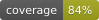

# Is the Gävle Goat Burning?



This project monitors the [Gävle Goat webcam](https://www.youtube.com/watch?v=P1VOrSoJXnc) feed to detect if the goat is on fire. It uses computer vision techniques to analyze the video feed and sends email and/or Discord notifications if fire is detected.

## Project Overview

The Gävle Goat is a giant straw goat built annually in Gävle, Sweden. It has become a tradition for vandals to attempt to burn it down. This project aims to provide real-time monitoring of the goat's status.

## Features

- **Real-time Fire Detection:** Utilizes computer vision to analyze the live webcam feed for signs of fire.
- **Advanced Fire Debouncing:** Prevents false positives from brief visual flickers by requiring a sustained detection before triggering alerts.
- **Email & Discord Notifications:** Sends immediate alerts to designated recipients via email and/or Discord webhooks.
- **Flexible Video Archiving:** Choose between two strategies for saving footage:
    - **Memory Mode (Default):** Keeps a pre-fire buffer in RAM for minimal disk I/O, flushing video to disk only when a fire is detected. This mode is optimized for performance and reduced wear on storage devices.
    - **Disk Mode:** Continuously saves video chunks to disk, ideal for systems with limited RAM.
- **Continuous Fire Recording:** Optionally record video for the entire duration of a fire event, plus a configured time after it is extinguished.
- **Video Chunks to Discord:** Optionally upload each saved video chunk (pre-fire buffer and post-fire chunks) to your Discord webhook(s) as they are archived, with a text fallback for files that exceed Discord's upload limit.
- **Dockerized Deployment:** Easily deployable with Docker, ensuring consistent performance across different environments.
- **CUDA Acceleration (Optional):** Supports CUDA for significantly faster processing on NVIDIA GPUs.

## Prerequisites

- Python 3.14 or higher
- NVIDIA GPU with CUDA drivers installed (if using CUDA acceleration)
- Docker (optional, for Docker deployment)

## INSTALLATION

1.  Clone the repository:
    ```bash
    git clone https://github.com/MilBia/IS-GOAT-BURNING.git
    cd IS-GOAT-BURNING
    ```

2.  Create and activate a virtual environment:
    ```bash
    python3 -m venv .venv
    source .venv/bin/activate
    ```

3.  Install dependencies:
    *   For a CPU-based installation:
        ```bash
        pip install .[cpu]
        ```
    *   For a GPU-based installation (requires a manual build of OpenCV with CUDA, see Docker instructions):
        ```bash
        pip install .
        ```

## Dependency Management

This project uses `pyproject.toml` as the single source of truth for all Python dependencies. The `requirements.txt`, `requirements-cpu.txt`, and `requirements-dev.txt` files are auto-generated from this file using `pip-tools`.

**Important: Do not edit the `requirements*.txt` files manually.**

The `requirements-in-sync` CI job re-runs the command from each file's header and fails if a file differs from the `pip-compile` output.

If you need to add or change a dependency, edit `pyproject.toml` and then run the following commands from the root of the project to regenerate the files:

```bash
pip-compile --output-file=requirements.txt pyproject.toml
pip-compile --extra=cpu --output-file=requirements-cpu.txt pyproject.toml
pip-compile --extra=dev --extra=cpu --output-file=requirements-dev.txt pyproject.toml
pip-compile --extra=openvino --unsafe-package=openvino-telemetry --output-file=requirements-openvino.txt pyproject.toml  # optional, hybrid_edge on OpenVINO (bare-metal)
```

`requirements-openvino.txt` deliberately leaves out `openvino-telemetry` (a dependency of `openvino` that would send usage data). Install it on top of the base install (`pip install .[cpu]`), fully pinned without dependency resolution: `pip install --no-deps -r requirements-openvino.txt` (`pip check` then reports the missing `openvino-telemetry`, which is expected). `pip install .[openvino]` would pull `openvino-telemetry` back in; the app still neutralises it in code.

For the offline `hybrid_edge` verifier (models, CUDA/OpenCL/OpenVINO setup, measured latency) see the [Hardware Acceleration Guide](docs/HARDWARE_ACCELERATION.md).

## CONFIGURATION

1.  Create a `.env` file by copying the example:

    ```bash
    cp .env.example .env
    ```

2.  Edit the `.env` file and fill in your configuration details. Here's a breakdown of each setting:

| Variable | Description | Default |
| --- | --- | --- |
| `SOURCE` | URL of the webcam feed. | `"https://youtu.be/vDFPpkp9krY"` |
| `FIRE_DETECTION_THRESHOLD` | Percentage of frame pixels to trigger fire detection. | `0.1` |
| `FIRE_DETECTION_MODE` | `frame_fraction` (threshold above) or `area_relative` (recommended for production, see [Production run](#production-run): share of the warm region that is moving; detects small fires). | `frame_fraction` |
| `AREA_RELATIVE_THRESHOLD` | Share of warm pixels that must be moving in `area_relative` mode (0–1). | `0.23` |
| `LOGGING` | Logging level (`DEBUG`, `INFO`, `WARNING`, `ERROR`). | `"INFO"` |
| `VIDEO_OUTPUT` | Display the video feed window (for local debugging only). | `false` |
| `CHECKS_PER_SECOND` | How many times per second to analyze the video. | `1.0` |
| `VERIFIER_COOLDOWN_SECONDS` | `hybrid_*` only: minimum seconds between verifier (API) calls; the last verdict is reused meanwhile. A "no fire" verdict is not reused while a fire was verified within the last cooldown + `FIRE_EXTINGUISHED_DEBOUNCE_SECONDS` (the verifier is asked again on the next check). The first "no fire" verdict after a fire (including one reported as unverified during an outage) is not reused for `FIRE_EXTINGUISHED_DEBOUNCE_SECONDS` either; the verifier is asked again on each check. So a single false negative cannot end an ongoing fire. `0` disables. | `60` |
| `VERIFIER_MAX_CALLS_PER_HOUR` | `hybrid_*` only: hard cap of verifier calls per rolling hour; at the cap the verifier counts as unavailable and `VERIFIER_FAILURE_POLICY` applies. `0` = unlimited. | `0` |
| `VERIFIER_FAILURE_POLICY` | `hybrid_*` only: what a CV detection yields while the verifier is unavailable (errors, timeouts, call cap). `alert_unverified` sends the alert marked as unverified; `suppress` sends nothing (CRITICAL log only) and, during an ongoing fire, ends it after the extinguish debounce (recording stops, alert re-arms). While unavailable, the verifier is probed at most once per `VERIFIER_COOLDOWN_SECONDS` and the policy result is reported in between. | `alert_unverified` |
| `VERIFIER_ERRORS_BEFORE_POLICY` | `hybrid_*` only: consecutive verifier errors before the policy applies (an error is never cached; the verifier is asked again on the next check; until then a check is inconclusive and the detection state is kept). | `3` |
| `OPEN_CL` | Enable OpenCL for acceleration (experimental). | `false` |
| `CUDA` | Enable CUDA for NVIDIA GPU acceleration. | `false` |
| `RECONNECT_DELAY_SECONDS` | Seconds to wait before the first reconnect to a failed stream; the wait doubles after every consecutive failure (exponential backoff) and resets after a session that ran for at least 60 s after its first frame (a stream that yields a frame and dies at once keeps backing off). | `5` |
| `RECONNECT_MAX_DELAY_SECONDS` | Upper limit of the reconnect wait (must be at least `RECONNECT_DELAY_SECONDS`). | `300` |
| `STREAM_INACTIVITY_TIMEOUT` | Seconds to wait for a new frame before timing out. | `60` |
| | | |
| **Detection Strategy** | | |
| `DETECTION_STRATEGY` | Strategy to use: `classic` (HSV), `gemini` (AI), `hybrid_cloud` (HSV + Gemini), `hybrid_edge` (HSV + local offline classifier, needs `EDGE__MODEL_PATH`; falls back to the local detector (classic rule, subject to `VERIFIER_FAILURE_POLICY`) if the model fails to load), `gemini_decision` (Decisions API) or `hybrid_decision` (HSV + Decisions API). | `"classic"` |
| `EDGE__ACCELERATOR` | `hybrid_edge` inference backend: `auto`, `cpu`, `cuda` (`cv2.dnn` CUDA; needs OpenCV built with CUDA, e.g. the Docker `gpu` image run with `--gpus all`; verified only by unit tests with mocks, not on NVIDIA hardware), `opencl`, `openvino` (CPU) or `openvino_gpu` (Intel iGPU); the OpenVINO values need OpenVINO (`pip install --no-deps -r requirements-openvino.txt`) and also accept an IR `.xml` model. `EDGE__CONFIDENCE_THRESHOLD` is specific to the model variant and device. See the [Hardware Acceleration Guide](docs/HARDWARE_ACCELERATION.md). | `"auto"` |
| `GEMINI__API_KEY` | Google Gemini API Key (required if strategy is `gemini`). | `""` |
| `GEMINI__MODEL` | Gemini model to use. | `"gemini-3.5-flash-lite"` |
| `GEMINI__PROMPT` | Prompt for the AI model. | `"Analyze this image..."` |
| `DECISION__MODEL` | Decisions API model (strategies `gemini_decision`, `hybrid_decision`; uses `GEMINI__API_KEY`). | `"gemini-decision-1"` |
| `DECISION__THRESHOLD` | Minimum `P(fire)` (0–1) to report fire. | `0.5` |
| `DECISION__INSTRUCTIONS` | Yes/no question asked about each frame. | `"Is there a visible fire..."` |
| `DECISION__TIMEOUT_SECONDS` | Per-request timeout in seconds. | `10` |
| `ESCALATION_LOG__ENABLED` | `hybrid_*` only: record every frame sent to the verifier as a JPEG plus a line in `escalations.jsonl` (time, file, verifier, verdict `fire`/`no_fire`/`error`/`capped`, probability, latency, error type, policy). Non-blocking; for threshold tuning. | `false` |
| `ESCALATION_LOG__DIRECTORY` | Directory of the escalation log. In Docker set it to `/app/recordings/escalations`: the default resolves to `/app/escalation_log`, which is owned by root while the app runs as `nobody` (every record would be dropped) and is not on the recordings volume. An unusable directory is reported once at startup as an ERROR. | `./escalation_log` |
| `ESCALATION_LOG__MAX_MB` | Size limit; the oldest JPEGs are deleted beyond it (index lines are kept, the index itself rotates). | `2000` |
| `ESCALATION_LOG__JPEG_QUALITY` | JPEG quality (1-100) of stored frames. | `85` |
| | | |
| **Debouncing** | | |
| `FIRE_DETECTED_DEBOUNCE_SECONDS` | Seconds a fire must be continuously detected before an alert is triggered. `0.0` for immediate. | `0.0` |
| `FIRE_EXTINGUISHED_DEBOUNCE_SECONDS`| Seconds a fire must be continuously absent before the 'extinguished' state is registered. | `5.0` |
| `ALERT_COOLDOWN_SECONDS` | One alert is sent per fire event; the alert re-arms once the fire is extinguished (or the stream drops mid-fire). This is the minimum spacing between two alerts: a fire re-detected inside the window is alerted when the window ends if it is still burning, otherwise not at all. `0` disables the spacing. | `600` |
| `ALERT_RETRY_SECONDS` | If every alert action failed (e.g. a short Discord outage at ignition), the alert is retried every this many seconds, with the same frame, until it is sent or the fire is extinguished. The detector signals only when a fire starts, so without the retry such an outage would lose the alert for the whole fire. `0` disables the retry. | `60` |
| `UNVERIFIED_ALERT_NOTE` | Note added to an alert sent while the verifier is unavailable (`VERIFIER_FAILURE_POLICY=alert_unverified`): appended to the email body (subject prefixed with `[UNVERIFIED] `) and to the Discord message as `[UNVERIFIED] <note>`. Max 500 characters. | `"The fire verifier is unavailable; this alert comes from the local camera detector only."` |
| | | |
| **Email Settings** | | |
| `EMAIL__USE_EMAILS` | Set to `true` to enable email notifications. | `false` |
| `EMAIL__SENDER` | Your sender email address. | `""` |
| `EMAIL__SENDER_PASSWORD` | Your email password or app password. | `""` |
| `EMAIL__RECIPIENTS` | JSON list of recipient emails, e.g. `["a@example.com","b@example.com"]` (a comma-separated value fails at startup; in a Docker `--env-file` write it unquoted). | `""` |
| `EMAIL__EMAIL_HOST` | SMTP server host (e.g., `smtp.gmail.com`). | `""` |
| `EMAIL__EMAIL_PORT` | SMTP server port (e.g., `587`). | `""` |
| | | |
| **Discord Settings** | | |
| `DISCORD__USE_DISCORD` | Set to `true` to enable Discord notifications. | `false` |
| `DISCORD__HOOKS` | JSON list of Discord webhook URLs, e.g. `["https://..."]`. | `""` |
| `DISCORD__SEND_VIDEO_CHUNKS` | Set to `true` to upload saved video chunks to Discord as they are archived around a fire event. Requires `VIDEO__SAVE_VIDEO_CHUNKS=true`. | `false` |
| `DISCORD__FILE_LIMIT_MB` | Largest video chunk uploaded to Discord, in MiB (1024*1024 bytes). Larger chunks, and chunks Discord rejects with HTTP 413, are replaced by a short text message with the file name and size. The webhook limit varies (measured: 18 MiB passes, 20.5 MiB is rejected); lower it if you still get 413. | `18` |
| `DISCORD__ATTACH_FRAME` | Attach a JPEG of the frame that triggered the alarm to the first Discord alert (downscaled to at most 1280 px wide). The text is sent even if the image cannot be produced. | `true` |
| `DISCORD__SERVICE_HOOKS` | JSON list of webhook URLs of a **separate** service channel ("sign of life"): startup, heartbeat, stream outage longer than the threshold (once) and its recovery, verifier unavailable / recovered, shutdown. Lets you tell a quiet alert channel from a dead monitor. Independent of `DISCORD__USE_DISCORD`; must not repeat a URL from `DISCORD__HOOKS`. Empty disables it. | `[]` |
| `DISCORD__SERVICE_HEARTBEAT_INTERVAL_SECONDS` | Interval of the service heartbeat (uptime, stream state, fire events since the last heartbeat, verifier availability). | `86400` |
| `DISCORD__SERVICE_STREAM_DOWN_WARNING_SECONDS` | A stream outage longer than this sends one warning to the service channel, and its recovery is reported. Shorter outages are silent. | `600` |
| | | |
| **Video Archiving** | | |
| `VIDEO__SAVE_VIDEO_CHUNKS` | Set to `true` to enable saving video to disk. | `false` |
| `VIDEO__VIDEO_OUTPUT_DIRECTORY` | Directory to save video files. | `"./recordings"` |
| `VIDEO__BUFFER_MODE` | Buffering strategy: `memory` (default), `disk` or `segments`. | `"memory"` |
| `VIDEO__SEGMENTS_DIRECTORY` | Ring directory for `segments` mode; must be a tmpfs (RAM) path. | `/dev/shm/goat-ring` |
| `VIDEO__SEGMENT_SECONDS` | Minimum duration of one ring segment in `segments` mode (cut on keyframes). | `2` |
| `VIDEO__MEMORY_BUFFER_SECONDS`| Duration (seconds) of pre-fire footage to keep in RAM in `memory` mode. | `60` |
| `VIDEO__VIDEO_CHUNK_LENGTH_SECONDS` | Length of each video chunk in seconds. | `300` |
| `VIDEO__MAX_VIDEO_CHUNKS` | Max number of `disk` mode chunks to keep (old ones are deleted). | `20` |
| `VIDEO__CHUNKS_TO_KEEP_AFTER_FIRE` | Defines the duration of post-fire recording (`chunks_to_keep * chunk_length`). | `10` |
| `VIDEO__RECORD_DURING_FIRE` | If `true`, recording continues for the entire fire duration plus the post-fire period. | `false` |
| `VIDEO__FLUSH_NUM_THREADS` | Number of threads for flushing memory buffer. Lower values reduce CPU contention. | `1` |
| `VIDEO__FLUSH_THROTTLE_FRAME_INTERVAL` | Number of frames to process before sleeping during flush. | `10` |
| `VIDEO__FLUSH_THROTTLE_SECONDS` | Duration (seconds) to sleep during flush throttle. | `0.01` |
| `VIDEO__FLUSH_THROTTLE_ENABLED` | If `true`, enables throttling during flush to reduce CPU/IO contention. | `false` |


**Important Notes**:

-   **Email Configuration:** For Gmail, you *must* generate an "App Password" in your Google account settings. Using your regular password is a security risk and may not work.
-   **Video Output:** `VIDEO_OUTPUT=true` is for local debugging only. Do not use it in a headless or Docker environment without X11 forwarding.
-   **CUDA:** `CUDA=true` requires a compatible NVIDIA GPU and properly installed drivers. See the Docker section for setup instructions.
-   **Video Buffer Mode (`VIDEO__BUFFER_MODE`):**
    -   `memory` (default): Holds a buffer of recent, compressed video frames in RAM. No data is written to disk during normal operation. When a fire is detected, this in-memory buffer is flushed to a file. This mode significantly reduces disk I/O but increases RAM usage. The amount of RAM needed is proportional to the buffer duration and video resolution/framerate.
    -   `segments`: One supervised `ffmpeg -c copy` process writes the original stream (no decoding, no re-encoding) into a ring of short segments in a tmpfs directory (`VIDEO__SEGMENTS_DIRECTORY`), sized by `VIDEO__MEMORY_BUFFER_SECONDS`. Frames are decoded only for analysis (`grab()` skips the rest), so CPU and RAM stay low (measured on a Raspberry Pi 4, live 1080p30 stream: ~0.8 core vs ~1.46 for `memory`, which also dropped ~1/3 of the frames there, with a ~26 MB ring vs ~1.6 GB; at 1080p60 the ring reaches ~120 MB for a 60 s buffer, ~250 MB for 120 s). On fire the segments are joined with `-c copy` into the pre-fire clip and recording continues until the fire is out. The ring is kept across reconnects (the stream URL expires every ~6 h) and quick restarts: only segments older than the pre-fire window are deleted at start, so a fire right after a reconnect still gets its pre-fire clip, with the reconnect time (a few seconds) missing from it; segments from before the reconnect are joined only when their codec and resolution match the new stream's (`ffprobe`), otherwise the clip starts at the reconnect (#160). Needs `ffmpeg`; in Docker give the container enough shared memory (the default `/dev/shm` is only 64 MB; use `--shm-size 1g` for a 60 fps source: the default overflows after ~80 s and `ffmpeg` falls into a restart loop, see #156; `256m` is enough for 30 fps). A warning is logged at start when the ring directory has less than 128 MB free.
    -   `disk`: Continuously saves video chunks to the disk. This has low RAM usage but causes constant disk I/O, which can be inefficient and cause wear on SSDs.
-   **Sending Video Chunks to Discord (`DISCORD__SEND_VIDEO_CHUNKS`):** When enabled (alongside `DISCORD__USE_DISCORD=true` and `VIDEO__SAVE_VIDEO_CHUNKS=true`), each video chunk archived around a fire event—starting with the pre-fire buffer and continuing with the post-fire chunks—is uploaded to the configured Discord webhook(s) as it is written. This gives you an instant, playable clip of the moments around the event. Chunks larger than `DISCORD__FILE_LIMIT_MB` (default 18 MiB), or rejected by Discord with HTTP 413 (the limit depends on the server), are not uploaded; a short text message with the file name and size is sent instead (`Goat on fire! A video chunk (<file>, <size> MiB) is too large to upload to Discord. It is saved on disk.`). To keep individual chunks small enough to upload, lower `VIDEO__VIDEO_CHUNK_LENGTH_SECONDS` and/or `VIDEO__MEMORY_BUFFER_SECONDS`.

### Recommended in-season settings

The defaults are conservative and were **not tuned for real fires**: in the evaluation of #104 the default
`FIRE_DETECTION_THRESHOLD=0.1` detected 0 of 11 real fire clips, while the unburnt goat peaks at only ~1.5 % of the
frame (so there is a large false-alarm margin to spend). The numbers below come from a narrow data set (one scene,
one time of day, one day of the year, no real Gävle fire footage), so the defaults in code are left unchanged until #109 is done.

Pick **one** of the two decision rules (they use different parameters). `area_relative` is the recommended one for production; `frame_fraction` with 0.05 is the older alternative:

| Rule | Settings | Evaluation result (#104, measured with debounce `0`) |
| --- | --- | --- |
| `frame_fraction` (default) | `FIRE_DETECTION_THRESHOLD=0.05` | 6/11 real clips, 0 steady-state alarms on the goat |
| `area_relative` | `FIRE_DETECTION_MODE=area_relative` (uses `AREA_RELATIVE_THRESHOLD`, default `0.23`; `FIRE_DETECTION_THRESHOLD` is ignored) | 9/11 real clips, 0 steady-state alarms on the goat |

Then consider a debounce and, preferably, a verifier. A debounce `D` needs `D + 1` consecutive alarmed checks at
`CHECKS_PER_SECOND=1` (3 s means 4 checks) and **costs recall** (#130, `area_relative`, measured on the narrow data
set above):

| `FIRE_DETECTED_DEBOUNCE_SECONDS` | Real clips detected (of 9) | Recall | Median time to alert |
| --- | --- | --- | --- |
| `0` | 8 | 0.74 | 3.5 s |
| `1` | 8 | 0.68 | 5.5 s |
| `2` | 8 | 0.64 | 8.5 s |
| `3` | 8 | 0.59 | 9.5 s |
| `5` | 8 | 0.50 | 12.5 s |
| `10` | 6 | 0.30 | 19 s |

Do **not** combine `FIRE_DETECTION_THRESHOLD=0.05` (`frame_fraction`) with a debounce: it detects 5, 4, 2, 0, 0, 0 of 9
clips for debounce 0, 1, 2, 3, 5, 10 s. The protective value of a debounce could not be measured (the goat data
contain no isolated single-check alarms), so `0` is not a recommendation either; `1`-`2` with `area_relative` is a
compromise until December data (#109). A longer `FIRE_EXTINGUISHED_DEBOUNCE_SECONDS` reduces repeated re-entries into
the fire state. The verifier is a plausible filter but has not been evaluated on these data yet:

```env
FIRE_DETECTION_MODE=area_relative
# D + 1 consecutive alarmed checks; see the table above (1-2 is a compromise)
FIRE_DETECTED_DEBOUNCE_SECONDS=2.0
# Or hybrid_cloud; needs GEMINI__API_KEY
DETECTION_STRATEGY=hybrid_decision
```

For the full production preset see [Production run](#production-run).

Known limits of the colour + motion rule (also with `area_relative`):

-   Fires smaller than ~0.5 % of the frame (a distant campfire) are not detected by any whole-frame variant that was tested.
-   Sped-up sunrise/sunset time-lapses and similar scenes where the whole picture changes between checks still
    raise false alarms with `area_relative` (4/5 in #104, 7/8 on the wider set in #105; sped-up time-lapses are a stress
    test, not a field estimate). A verifier (`hybrid_cloud`, `hybrid_decision`) is the only filter available for that,
    but it has not been evaluated on these scenes yet.
-   `hybrid_edge` needs a trained model that is not published yet (#73); do not use it in production before then.
-   `AREA_RELATIVE_THRESHOLD` was chosen on the same narrow data set; a better value is tracked in #128.

## HOW TO RUN

### Usage Python Directly:

1.  Ensure you have CUDA-enabled OpenCV installed if `CUDA` is set to `true`.

    - To verify CUDA-enabled OpenCV: after installing opencv run this command:
      ```bash
      python -c "import cv2; print(cv2.cuda.getCudaEnabledDeviceCount())"
      ```
      If it outputs a number greater than 0, CUDA is enabled.

2.  Run the project:

    ```bash
    python burning_goat_detection.py
    ```

### Use Docker:

Docker allows you to run the application in a consistent and isolated environment.  The following steps guide you through building and running the Docker image, with and without GPU support.

1.  **Install Docker:** If you haven't already, install Docker Desktop from [docker-desktop](https://www.docker.com/products/docker-desktop/). Follow the instructions for your operating system.

2.  **Install the NVIDIA Container Toolkit (REQUIRED for CUDA):**
    If you want to use CUDA acceleration within Docker, you *must* install the NVIDIA Container Toolkit on your host machine. This toolkit allows Docker containers to access your NVIDIA GPU.

    -   Follow the instructions for your operating system here: [NVIDIA Container Toolkit Installation Guide](https://docs.nvidia.com/datacenter/cloud-native/container-toolkit/latest/install-guide.html)
    -   **Important:**  After installing the NVIDIA Container Toolkit, you may need to restart your Docker daemon or your entire system for the changes to take effect.

3.  **Determine your GPU's Compute Capability (REQUIRED for CUDA):**
    -  CUDA applications are compiled for specific GPU architectures, identified by their "compute capability".  You need to determine your GPU's compute capability and set the `CUDA_ARCH_BIN` build argument accordingly.
    -  You can find your GPU's compute capability on NVIDIA's website.
    -  You will use this value in the `docker build` command.

4.  **Build the Docker image:**

    The `cpu` image installs OpenCV from the `opencv-python` wheel; the `gpu` and `opencl` images build the same OpenCV version (currently 5.1.0, with `opencv_contrib`) from source.

    -  **Base run (CPU only):** This build will run the application using the CPU. This is suitable if you don't have an NVIDIA GPU or don't want to use CUDA.
        ```bash
        docker build --target cpu -t burning_goat_detection .
        ```

    -  **With GPU support (CUDA):** This build will run the application using the GPU.
        ```bash
        docker build --target gpu --build-arg CUDA_ARCH=YOUR_GPU_COMPUTE_CAPABILITY -t burning_goat_detection .
        ```
        -   **Replace `YOUR_GPU_COMPUTE_CAPABILITY` with the compute capability you determined in the previous step.** For example, if your GPU's compute capability is 8.6, the command would be:
            ```bash
            docker build --target gpu --build-arg CUDA_ARCH=8.6 -t burning_goat_detection .
            ```
        -   The `--build-arg CUDA_ARCH` flag passes the GPU architecture to the Dockerfile, which uses it to optimize the OpenCV build for your specific GPU.  If you skip this step, the application might not run correctly or might not use the GPU effectively.

    -  **With OpenCL support (Intel/AMD/RPi):** This build will run the application using OpenCL acceleration.
        ```bash
        docker build --target opencl -t burning_goat_detection .
        ```
        -   The `opencl` image is based on Ubuntu 26.04 for its Intel compute runtime (recent Intel iGPUs such as Alder Lake-N); see the [Hardware Acceleration Guide](docs/HARDWARE_ACCELERATION.md).

5.  **Run the Docker container:**

    -  **Base run (CPU only):**
        ```bash
        docker run --name burning_goat_detection_container -d burning_goat_detection
        ```
        -   To save video chunks to your local machine, you need to mount a volume using the `-v` flag. By default, this maps to `/app/recordings` inside the container.
            -   **Example:**
                ```bash
                docker run --name burning_goat_detection_container -v /path/to/your/local/recordings:/app/recordings -d burning_goat_detection
                ```
            -   In this example, `/path/to/your/local/recordings` is a directory on your computer where you want to save the videos. The `/app/recordings` part is the default path inside the container. If you need to change this, please see the **Using a Custom Recordings Directory** section below.

    -  **With GPU support (CUDA):**
        ```bash
        docker run --gpus all --name burning_goat_detection_container -d burning_goat_detection
        ```
        -   `--gpus all`:  This flag is **critical** for enabling CUDA acceleration. It tells Docker to make all available GPUs accessible to the container. If you only want to use specific GPUs, you can specify their IDs instead (e.g., `--gpus device=0,1`).
        -   To save video chunks, mount a volume as shown above.
            -   **Example:**
                ```bash
                docker run --gpus all --name burning_goat_detection_container -v /path/to/your/local/recordings:/app/recordings -d burning_goat_detection
                ```
            -   In this example, `/path/to/your/local/recordings` is a directory on your computer where you want to save the videos. The `/app/recordings` part is the default path inside the container. If you need to change this, please see the **Using a Custom Recordings Directory** section below.

    -   **With OpenCL support (Intel/AMD/RPi):**
        You need to map the DRI devices to the container to allow access to the GPU.
        ```bash
        docker run --device /dev/dri:/dev/dri --name burning_goat_detection_container -d burning_goat_detection
        ```
        -   **Raspberry Pi Note:** Ensure you are using the KMS driver (dtoverlay=vc4-kms-v3d) in `/boot/config.txt`.

    -   **Configuring with an `.env` file:**
        The recommended way to provide configuration (like email credentials or Discord webhooks) is to use an `.env` file with the `--env-file` flag. This securely injects all your settings into the container.

        - **Example:**
          ```bash
          docker run --name burning_goat_detection_container \
            --env-file .env \
            -v /path/to/your/local/recordings:/app/recordings \
            -d burning_goat_detection
          ```

    -  **Using a Custom Recordings Directory:**
        If you wish to change the directory where videos are saved inside the container, you must update both the volume mount (`-v`) and provide the `VIDEO__VIDEO_OUTPUT_DIRECTORY` environment variable (`-e`). **The path for the environment variable must match the container-side path of the volume mount.**

        -   **Example with a custom directory:**
            ```bash
            docker run --name burning_goat_detection_container \
              -v /path/to/your/local/custom_vids:/app/custom_vids \
              -e VIDEO__VIDEO_OUTPUT_DIRECTORY=/app/custom_vids \
              -d burning_goat_detection
            ```

        If the escalation log is enabled, point `ESCALATION_LOG__DIRECTORY` at a location under that same directory (e.g. `/app/custom_vids/escalations`) so it is writable and covered by the volume mount.

6.  **Accessing Container Logs:** To view the application's output and check for errors, you can view the container's logs:
    ```bash
    docker logs burning_goat_detection_container
    ```

7.  **Stopping and Starting the Container:**
    ```bash
    docker stop burning_goat_detection_container
    docker start burning_goat_detection_container
    ```

### Production run

> **Warning:** the defaults (`FIRE_DETECTION_MODE=frame_fraction`, `FIRE_DETECTION_THRESHOLD=0.1`) detected 0 of 11
> real fires in #104. For a real deployment `FIRE_DETECTION_MODE=area_relative` is **mandatory**.

```bash
docker build --target cpu -t burning_goat_detection .

docker run -d --name burning_goat_detection_container \
  --restart unless-stopped \
  --stop-timeout 30 \
  --shm-size 1g \
  --env-file /path/outside/repo/goat.env \
  -v /path/to/recordings:/app/recordings \
  burning_goat_detection
```

-   `--restart unless-stopped` brings the container back after a crash or host reboot.
-   `--stop-timeout 30` gives the graceful shutdown (final clip, pending alert, service message) time to finish; it can take ~15 s, more than Docker's default 10 s grace period.
-   `--shm-size 1g` is **required** in `segments` mode: the default 64 MB `/dev/shm` overflows at 60 fps after ~80 s and `ffmpeg` falls into a restart loop (#156). A 1080p60 ring of 120 s takes ~250 MB.
-   Keep the env file **outside the repository** with mode `600` (`chmod 600 goat.env`); it holds the Gemini key and webhooks.
-   Recordings: 20 s of 1080p60 is 10-18 MB, so budget ~2.5 GB of disk per hour of fire.
-   Optional hardening: to limit the container's outbound traffic to the services your configuration needs (YouTube, Discord, Gemini, SMTP), run it behind the allow-list proxy in `deploy/egress/`; see [Egress-restricted deployment](docs/runbook.md#8-egress-restricted-deployment) in the runbook. `tools/egress_allowlist.py` prints the required hosts from your settings.

Recommended production preset (names match `is_goat_burning/config.py`; secrets are placeholders). Docker env files do **not** strip quotes, so write values unquoted and put comments on their own lines (no inline comments):

```env
SOURCE=<stream URL>
YTDLP_FORMAT=bestvideo/best
CHECKS_PER_SECOND=1.0

# CV gatekeeper (mandatory, see the warning above)
FIRE_DETECTION_MODE=area_relative
AREA_RELATIVE_THRESHOLD=0.23
# 1 s chosen because the verifier filters false positives (see below)
FIRE_DETECTED_DEBOUNCE_SECONDS=1.0
FIRE_EXTINGUISHED_DEBOUNCE_SECONDS=10.0

# Verifier. Measured in E3 (164 frames; the goat frames were all daytime, so night behaviour is unmeasured):
# default DECISION__INSTRUCTIONS with threshold 0.40 -> 88 % recall, 0/107 false alarms (95 % CI upper bound ~3 %). The code default
# threshold is 0.5; 0.40 is a recommendation, not a default.
# Fallback: DETECTION_STRATEGY=hybrid_cloud with the default GEMINI__PROMPT.
DETECTION_STRATEGY=hybrid_decision
GEMINI__API_KEY=<key>
DECISION__THRESHOLD=0.40
DECISION__TIMEOUT_SECONDS=10
VERIFIER_COOLDOWN_SECONDS=30
VERIFIER_MAX_CALLS_PER_HOUR=0
VERIFIER_FAILURE_POLICY=alert_unverified
VERIFIER_ERRORS_BEFORE_POLICY=3
ALERT_COOLDOWN_SECONDS=600
ALERT_RETRY_SECONDS=60

# Escalation log: every frame sent to the verifier, with its verdict (for threshold tuning).
# Must be on the recordings volume: the default ./escalation_log is not writable by the container user.
ESCALATION_LOG__ENABLED=true
ESCALATION_LOG__DIRECTORY=/app/recordings/escalations
ESCALATION_LOG__MAX_MB=2000

# Stream reconnect
# Measured: with the 300 s default, recovery after a 12-min network outage took 4 min 13 s
RECONNECT_MAX_DELAY_SECONDS=120

# Discord
DISCORD__USE_DISCORD=true
DISCORD__HOOKS=["<webhook URL>"]
# Keep false unless clips fit DISCORD__FILE_LIMIT_MB (larger ones become a text message)
DISCORD__SEND_VIDEO_CHUNKS=false
# Service channel (startup, heartbeat, stream outage, verifier health, shutdown); must differ from DISCORD__HOOKS
DISCORD__SERVICE_HOOKS=["<service webhook URL>"]
# 6 h instead of the 24 h default: a silent monitor is noticed within hours
DISCORD__SERVICE_HEARTBEAT_INTERVAL_SECONDS=21600
DISCORD__SERVICE_STREAM_DOWN_WARNING_SECONDS=600

# Recording
VIDEO__SAVE_VIDEO_CHUNKS=true
VIDEO__VIDEO_OUTPUT_DIRECTORY=/app/recordings
VIDEO__BUFFER_MODE=segments
VIDEO__MEMORY_BUFFER_SECONDS=120
VIDEO__SEGMENTS_DIRECTORY=/dev/shm/goat-ring
VIDEO__SEGMENT_SECONDS=2
VIDEO__VIDEO_CHUNK_LENGTH_SECONDS=20
VIDEO__CHUNKS_TO_KEEP_AFTER_FIRE=10
VIDEO__RECORD_DURING_FIRE=true
```

Debounce: 1.0 here and 2.0 in the in-season block above are both inside the measured 1-2 s compromise (#130); 1.0 is preferred in production because the Gemini verifier filters false positives, so lower latency wins. `frame_fraction` with `FIRE_DETECTION_THRESHOLD=0.05` remains the older alternative (6/11 clips) but must not be combined with a debounce.

`VERIFIER_FAILURE_POLICY=alert_unverified` means that when the verifier is unavailable, CV detections are still
alerted (marked `[UNVERIFIED]`) instead of being silenced. After start, `docker logs` should show in order:
`Successfully resolved stream URL`, `Segments ring: N slots`, `Initialized hybrid detector with verifier ...`,
`Segment archiver (ffmpeg -c copy) started`.

Day-to-day operation, day-zero checklist and a failure table are in the [operations runbook](docs/runbook.md).

## Testing

This project uses `pytest` for unit and integration testing. A comprehensive test suite is located in the `tests/` directory.

### Running Tests Locally

It is recommended to run tests within a virtual environment.

1.  **Install Development Dependencies:**
    ```bash
    # Install main, dev, and cpu dependencies
    pip install -r requirements-dev.txt
    ```

2.  **Run the Test Suite:**
    The `PYTHONPATH=.` prefix is essential for ensuring that `pytest` can correctly locate the application modules.
    ```bash
    PYTHONPATH=. pytest
    ```

### Running Tests in Docker

This is the recommended way to validate changes in a clean, production-like environment.

#### CPU Tests

1.  **Build the CPU Test Image:**
    This command builds the `cpu-test` stage, which is based on the `cpu` image.
    ```bash
    docker build --target cpu-test -t goat-detector:test-cpu .
    ```

2.  **Run the CPU Test Suite:**
    The container will start, run `pytest`, and then remove itself.
    ```bash
    docker run --rm goat-detector:test-cpu
    ```

#### GPU Tests

1.  **Build the GPU Test Image:**
    This command builds the `gpu-test` stage, which is based on the `gpu` image and includes the necessary dependencies for running tests in a GPU-enabled environment.
    ```bash
    docker build --target gpu-test -t goat-detector:test-gpu .
    ```

2.  **Run the GPU Test Suite:**
    This command runs the GPU test image, enabling GPU access for the container. The CUDA-specific tests will now be executed.
    ```bash
    docker run --rm --gpus all goat-detector:test-gpu
    ```

#### OpenCL Tests

1.  **Build the OpenCL Test Image:**
    ```bash
    docker build --target opencl-test -t goat-detector:test-opencl .
    ```

2.  **Run the OpenCL Test Suite:**
    ```bash
    docker run --rm --device /dev/dri:/dev/dri goat-detector:test-opencl
    ```

## Troubleshooting Docker/CUDA Issues

*   **"CUDA driver version is insufficient for CUDA runtime version" Error:** This usually means that the CUDA drivers on your host machine are older than the CUDA version used in the Docker image. Update your NVIDIA drivers to the latest version.
*   **Application Runs on CPU Instead of GPU:**
    *   Ensure that you have correctly installed the NVIDIA Container Toolkit.
    *   Verify that you are passing the `--gpus all` flag to the `docker run` command.
    *   Check the application logs within the container for any CUDA-related errors.
*   **"Could not load cuDNN" Error:** This indicates that the cuDNN libraries are not correctly installed or configured in the Docker image.  Verify that the base image in your `Dockerfile_cuda` includes cuDNN (e.g., `nvidia/cuda:12.3.2-cudnn9-devel-ubuntu22.04`).

## Diagnosing a Running Process

Python 3.14 ships introspection tools that work on a live process without code changes (the target process must run the same Python version):

*   `python -m asyncio ps <PID>` — list all asyncio tasks of the process (useful when the detector/reconnect loop seems stuck).
*   `python -m asyncio pstree <PID>` — show the task tree (the `TaskGroup` in `Application`, the detector task, ...).
*   `python -m pdb -p <PID>` — attach the debugger to the running process.

Attaching may require elevated privileges (`ptrace` scope); see the Python docs for "remote debugging attachment protocol".

When running in Docker, run these commands *inside* the container (`docker exec -it <container> ...`); the container must be started with `--cap-add=SYS_PTRACE`. They can be disabled with `PYTHON_DISABLE_REMOTE_DEBUG=1` or `-X disable-remote-debug`.

## SOURCES

-   [Gävle Goat](https://en.wikipedia.org/wiki/G%C3%A4vle_goat) - Information about the Gävle Goat.
-   [yt-dlp](https://pypi.org/project/yt-dlp/) - A youtube-dl fork with additional features.
-   [Fire Detection System](https://github.com/gunarakulangunaretnam/fire-detection-system-in-python-opencv) - The core computer vision logic for fire detection.
-   [Python Email Examples](https://docs.python.org/3/library/email.examples.html) - Example on email sending using python

## Contributing

Contributions are welcome! Please open an issue or submit a pull request.

## CODING STANDARD

We use `pre-commit` with `ruff` to ensure consistent code formatting and linting.

**Setup:**

1.  Install development dependencies:
    ```bash
    pip install -e .[dev,cpu]
    ```
2.  Activate hooks: `pre-commit install`
3.  Run checks: `pre-commit run --all-files`

**How to contribute**

-   Ensure you have set up your pre-commit hooks.

Let's keep the Gävle Goat on check! 🐐🔥
